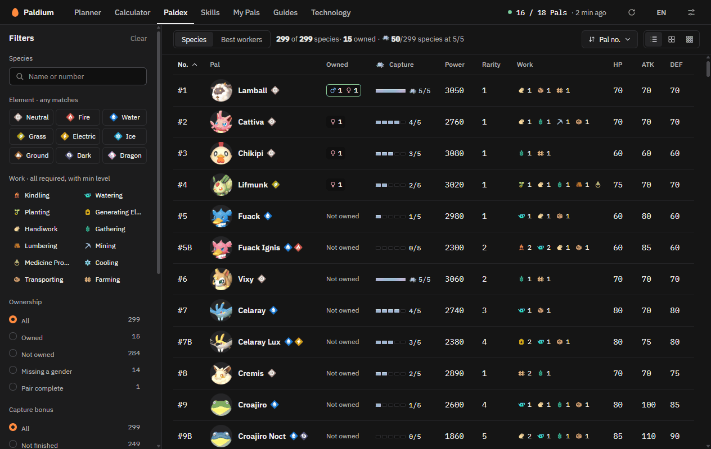
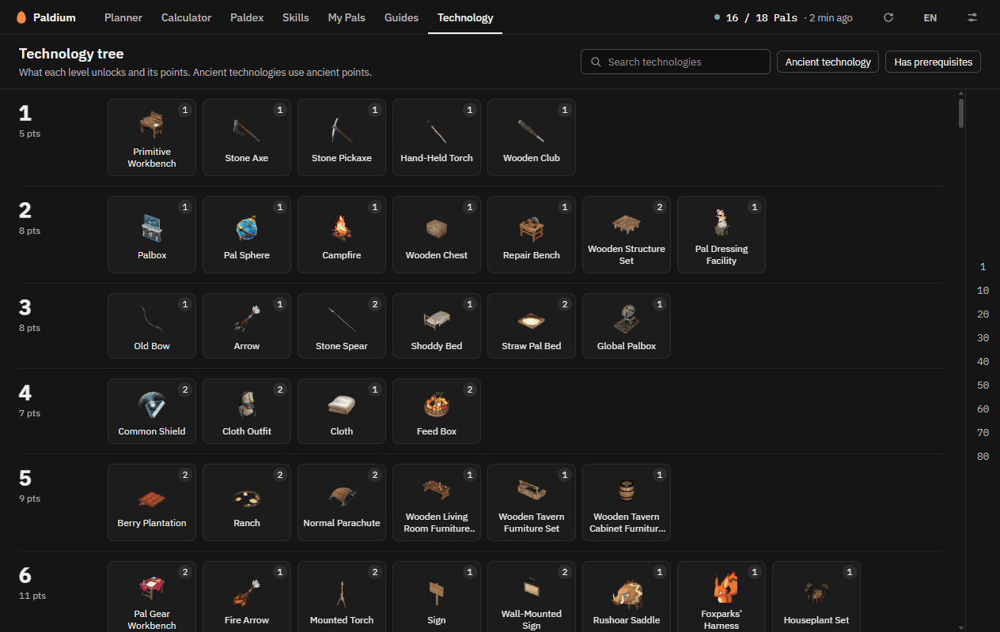

# Paldium

A Windows desktop tool for **Palworld** (tested with 1.0.5): a breeding planner and calculator, a Paldex with capture progress, skills, your own Pals, guides and the technology tree. It reads your save files and runs offline; nothing is written to your saves.




*The screenshots use made-up sample Pals.*

## What it does

- **Planner and Calculator:** the cheapest breeding path to a Pal with the passives you want, and what a given pair produces.
- **Paldex:** every Pal with stats, work suitability, where to find it, and your capture progress (5 catches per species, the Mimog effigy bonus).
- **Skills:** active skills, passives and partner skills.
- **My Pals:** the Pals you own, read from the world folder of a save, a ZIP of it, or the optional assist mod (for when you play as a client in someone else's world).
- **Guides:** ranch, transport, mounts and effigies (Pal Effigy progress per type).
- **Technology:** the tech tree by level with points, prerequisites and what each entry unlocks.
- English and Turkish.

## Download

Get the latest `Paldium-<version>-win-x64.zip` from the [Releases](https://github.com/MertKocakaplan/Paldium/releases) page, extract the `Paldium` folder anywhere you can write to (for example `Documents\Paldium`) and run `Paldium.exe` inside it. Each release also has a `.sha256` file with the checksum of the zip.

Requirements:

- Windows 10 or 11 (x64)
- [.NET 10 Desktop Runtime](https://dotnet.microsoft.com/download/dotnet/10.0)
- WebView2 Runtime (already on Windows 11)
- Visual C++ 2015+ x64 Redistributable (needed to read Palworld saves)

### Updates

Paldium checks GitHub Releases for a newer version a few seconds after it starts and then once a day (you can switch this off in *Settings > Updates*). When there is one, a badge appears in the top bar; *Update and restart* downloads the zip, checks it against its SHA-256, replaces the app files and starts the new version. Your data is not touched, and the old version is put back if something goes wrong.

### The assist mod (optional)

If you play as a client in a friend's co-op world, your own Pal Box is not in any file on your PC. The assist mod (a small [UE4SS](https://github.com/UE4SS-RE/RE-UE4SS) Lua mod, `mod/PaldiumBridge`) reads it while the game runs. With UE4SS set up for Palworld, open *Settings > Sources* in Paldium and press *Install mod* (with the game closed). It only reads; nothing is sent to the server and no game state is changed.

## Build from source

```
git clone --recurse-submodules https://github.com/MertKocakaplan/Paldium.git
cd Paldium
dotnet build Paldium.sln -c Release
dotnet test
dotnet run --project src/Paldium.App
```

If you cloned without submodules: `git submodule update --init`. You need the .NET 10 SDK (`winget install Microsoft.DotNet.SDK.10`).

- `data/` is the data bundle the app reads. It is built from the game files with `tools/Paldium.GameExtractor` (needs your own Palworld installation and a `.usmap` mapping file) and `tools/Paldium.DataBuilder`.
- `build/publish.ps1` makes the release package: `artifacts/Paldium-<version>-win-x64.zip` and its `.sha256`. The version is in `Directory.Build.props`. A release on GitHub is tagged `v<version>` and carries both files.

## Notes

Paldium is an unofficial fan project. It is not affiliated with or endorsed by Pocketpair, Inc. Palworld and its names, texts and images belong to Pocketpair.

## License

Copyright (C) 2026 Mert Kocakaplan

This program is free software: you can redistribute it and/or modify it under the terms of the GNU General Public License as published by the Free Software Foundation, either version 3 of the License, or (at your option) any later version.

The source code is licensed under [GPL-3.0](LICENSE); the game data and images in `data/` are **not** covered by this license and remain the property of Pocketpair, Inc. v0.1.0 was published under MIT; from v0.1.1 on, Paldium is licensed under GPL-3.0 because it bundles `libooz` (GPL-3.0). See [THIRD-PARTY-NOTICES.md](THIRD-PARTY-NOTICES.md) for `ooz`/`libooz`, PalCalc, fonts and packages.

---

## Türkçe (kısa)

**Paldium**, Palworld için bir Windows masaüstü aracıdır: üreme planlayıcı ve hesaplayıcı, yakalama ilerlemeli Paldex, yetenekler, kendi Pal'ların, rehberler ve teknoloji ağacı. Kayıt dosyalarını okur, çevrimdışı çalışır ve kayıtlarına hiçbir şey yazmaz.

- **İndirme:** [Releases](https://github.com/MertKocakaplan/Paldium/releases) sayfasındaki `Paldium-<sürüm>-win-x64.zip` arşivindeki `Paldium` klasörünü yazabileceğin bir yere çıkar ve içindeki `Paldium.exe`'yi çalıştır. Gereksinimler: Windows 10/11, .NET 10 Desktop Runtime, WebView2 ve Visual C++ Redistributable.
- **Güncelleme:** uygulama açılışta ve günde bir kez GitHub'da yeni sürüm arar (*Ayarlar > Güncellemeler*'den kapatılır). Yeni sürümde üst çubukta bir rozet çıkar; *Güncelle ve yeniden başlat* zip'i indirir, SHA-256'yı doğrular, dosyaları değiştirir ve yeni sürümü açar. Verilerine dokunulmaz.
- **Yardımcı mod (isteğe bağlı):** başkasının dünyasında istemci olarak oynuyorsan, Pal Kutun hiçbir dosyada bulunmaz. UE4SS kuruluyken *Ayarlar > Kaynaklar*'ndan *Modu kur*'a bas (oyun kapalıyken).
- **Kaynaktan derleme:** yukarıdaki komutlar; `--recurse-submodules` ile klonla.
- **Lisans:** resmî olmayan bir hayran projesidir; Palworld ve görselleri Pocketpair'e aittir ve bu lisansın dışındadır. v0.1.0 MIT olarak yayımlandı; v0.1.1'den itibaren paketteki `libooz` (GPL-3.0) nedeniyle kaynak kod **GPL-3.0** lisanslıdır ([LICENSE](LICENSE), [THIRD-PARTY-NOTICES.md](THIRD-PARTY-NOTICES.md)).
